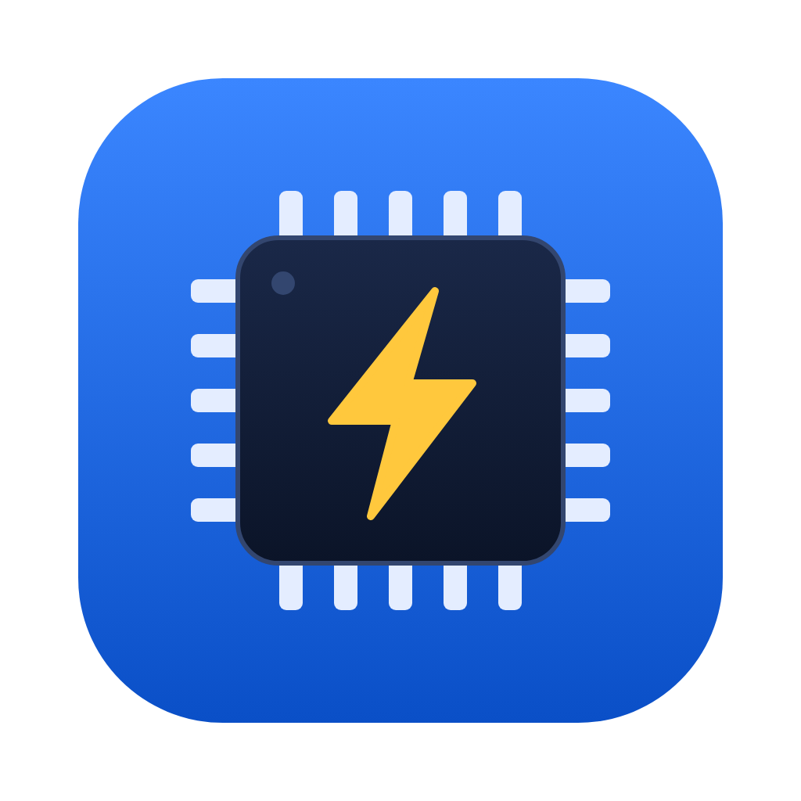

<p align="center">
  
</p>

<h1 align="center">stlink-rust-ui</h1>

<p align="center">
  A small, native-feeling desktop app for flashing STM32 microcontrollers through an ST-Link.<br>
  Written in Rust (USB and protocol) and Tauri + React (UI). Works with cheap ST-Link V2 clones.
</p>

<p align="center">
  <a href="https://github.com/winkelstein/stlink-rust-ui/actions/workflows/ci.yml"></a>
</p>

---

## Features

- **Identify** the probe and the target, like `st-info --probe`: firmware version, serial, target voltage, chip, core, flash and SRAM size, UID, read protection.
- **Flash** a `.bin` with a preview of exactly which pages or sectors will be erased, then program and verify.
- **Read** the whole flash, one bank or a range into a `.bin`.
- **Erase all** (mass erase), behind an explicit confirmation.
- **Quick flash**: the last file and address are remembered per chip; ⌘R / Ctrl+R re-flashes it, and the app can re-flash automatically whenever your build overwrites the file.
- **Plays well with other tools**: the app never grabs the ST-Link on its own. Press **Connect** to use it and **Disconnect** to hand it back to VS Code, OpenOCD or st-flash without closing the app.
- **Log** with a verbose USB packet trace for bug reports.
- English and Russian UI, light and dark theme, hot-plug.
- A command-line tool, `stlink-cli`, built on the same library.

## Supported hardware

**Probes:** ST-Link V2 (including clones, `0483:3748`), V2-1 and V3, over SWD.

| Family | Identify | Read | Flash / erase | Verified |
|---|---|---|---|---|
| STM32H72x/H73x, H74x/H75x | ✅ | ✅ | ✅ | on hardware (STM32H743) |
| STM32F0, F1 (incl. XL-density), F3 | ✅ | ✅ | ✅ | tests only |
| STM32F2, F4 (incl. F42x/F43x dual bank) | ✅ | ✅ | ✅ | tests only (F427 planned) |
| STM32F7 | ✅ | ✅ | ✅ | tests only |
| STM32G4 | ✅ | ✅ | ✅ | tests only |
| Other STM32 (from the stlink chip table) | ✅ | ✅ | Not yet | |

"Tests only" means the flash driver is tested against a register model of the controller (`stlink/src/flash/fake.rs`), not yet on a real board; the steps to verify a family are in [docs/hardware-checklist.md](docs/hardware-checklist.md). F0/F1/F3 need ST-Link firmware with 16-bit memory access (V2 J26 or later). USB DFU (flashing through the STM32 system bootloader without a probe) is planned.

## Install

Download the installer for your OS, or the `stlink-cli` archive, from [Releases](https://github.com/winkelstein/stlink-rust-ui/releases). Each release has `SHA256SUMS.txt`; check it with `sha256sum -c SHA256SUMS.txt`.

The same files are in [GitHub Packages](https://github.com/winkelstein/stlink-rust-ui/pkgs/container/stlink-rust-ui) as an OCI artifact:

```bash
oras pull ghcr.io/winkelstein/stlink-rust-ui:latest
```

Builds of every commit are in the artifacts of the [CI runs](https://github.com/winkelstein/stlink-rust-ui/actions/workflows/ci.yml).

- **macOS**: builds are not notarized yet. Open the app the first time with right-click → Open (or System Settings → Privacy & Security → Open Anyway).
- **Windows**: the ST-Link must use the WinUSB driver from ST ([STSW-LINK009](https://www.st.com/en/development-tools/stsw-link009.html), also installed by STM32CubeProgrammer). SmartScreen warns about unsigned builds: More info → Run anyway. Details in [docs/windows.md](docs/windows.md).
- **Linux**: AppImage and deb are built in CI but not tested yet. You will need a udev rule giving your user access to the ST-Link.

## Build from source

Requirements: Rust 1.85+, Node.js 22, and the [Tauri 2 prerequisites](https://v2.tauri.app/start/prerequisites/) for your OS.

```bash
npm ci
npm run tauri dev        # run the app
npm run tauri build      # build installers into target/release/bundle
npm run dev              # UI only, in the browser, with a mock backend
```

Checks (the same as CI):

```bash
cargo fmt --all --check
cargo clippy --workspace --all-targets -- -D warnings
cargo test --workspace
npm run build && npm test
```

## Command line

```bash
cargo run -p stlink-cli -- list                      # connected probes
cargo run -p stlink-cli -- probe                     # probe + target info
cargo run -p stlink-cli -- regs                      # halt, print core registers, resume
cargo run -p stlink-cli -- read dump.bin             # read the whole flash
cargo run -p stlink-cli -- write firmware.bin        # erase, program, verify, reset
cargo run -p stlink-cli -- erase-all                 # mass erase
```

Useful flags: `--freq <kHz>`, `--connect-under-reset`, `--keep-debug-in-low-power`, `-vvv` (hex trace of every USB packet).

## Repository layout

| Path | What |
|---|---|
| `stlink/` | Rust library: USB transport ([nusb](https://docs.rs/nusb)), ST-Link protocol, SWD/Cortex-M debug, chip table, flash drivers |
| `stlink-cli/` | Command-line tool and hardware test bench |
| `src-tauri/` | Tauri backend: device worker, hot-plug, settings, log |
| `src/` | React + TypeScript frontend |
| `docs/` | [PRD](docs/PRD-stlink-rust-ui-2026-10-17.md), [design](docs/design/README.md), [Windows notes](docs/windows.md), [build and release](docs/release.md) |

Contributor and agent notes (architecture, bench quirks, rules) are in [CLAUDE.md](CLAUDE.md).

## License

Licensed under either of MIT or Apache-2.0, at your option.

The chip description files in `stlink/chips/stlink/` come from [stlink](https://github.com/stlink-org/stlink) (BSD-3-Clause); see [NOTICE](NOTICE). OpenOCD was consulted for protocol knowledge only; no OpenOCD code is included.
